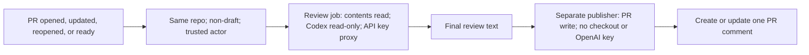

# Automated Codex PR reviews

The [workflow](../workflows/codex-review.yml) uses the official
[`openai/codex-action@v1`](https://learn.chatgpt.com/docs/github-action).
Its [review prompt](prompts/review.md) focuses on Nexa Wallet's FastAPI,
authentication, database, and money-movement rules.

## Enable it

1. Commit and push these files to GitHub. Make sure the prompt file is present
   on the PR branch being reviewed.
2. In repository **Settings → Secrets and variables → Actions**, add a repository
   secret named `OPENAI_API_KEY` with an OpenAI API key. Never put the key in a
   committed file or PR comment. Runs use your OpenAI API account and can incur
   API charges.
3. Allow GitHub Actions and the referenced actions in repository/organization
   settings. Policies must permit this workflow's comment-writing job.
4. Open a non-draft PR from a branch in the same repository using an account
   with repository write access, or push another commit to an existing PR.
5. Check **Actions → Codex PR review**. A successful run creates or updates one
   `github-actions[bot]` comment with findings and the reviewed commit SHA.

The key is checked without printing it. Missing configuration fails the review
job with a clear message. No key is needed for local editing of these files.

## Behavior and permissions

- Review uses the merge-base diff between the event's base/head commits and
  inspects related source. The model uses the action's default configuration.
- Only the review job receives the OpenAI key. Codex runs last in that job with
  `sandbox: read-only` and `safety-strategy: drop-sudo`. Checkout does not persist
  GitHub credentials.
- Publishing has `pull-requests: write`; it treats review output as comment data
  and executes no checked-out repository code. Old-commit/closed-PR feedback is
  skipped when detected before publication. New runs cancel earlier PR runs.
- Fork and Dependabot PRs are skipped. The action additionally restricts
  triggering users to write collaborators by default. Do not switch this to
  `pull_request_target` and check out untrusted PR code with secrets.
- Same-repository collaborators are trusted: PR changes can alter the workflow
  or prompt. Review permissions do not make arbitrary collaborator changes
  safe. Fork support would need a separate design.
- This posts an advisory summary comment, not inline GitHub review annotations,
  automatic fixes, or a merge approval. Findings do not deliberately fail the
  workflow; action/API failures do. No branch protections are changed.
- The reviewer does not execute tests or start PostgreSQL/Redis. Deterministic
  tests and linting belong in their own CI jobs.

## Verification status

Local checks passed: YAML parsing, event/permission/sandbox configuration,
publisher JavaScript syntax, and mocked comment creation/update, closed/stale PR
skips, blank output, truncation, marker ownership, and literal review text.
These checks do not substitute for GitHub's workflow validation or a live run.
An end-to-end review still requires pushing to GitHub, configuring the secret,
and opening/updating a qualifying PR. Local preparation does not activate the
GitHub workflow or verify API/model access for your account.
