# Nexa Wallet — Business and Design Guide

This is a learning reference for understanding what the project does, why its rules exist, how its tables relate, and how those decisions appear in the code. Read it alongside [PROGRESS.md](PROGRESS.md), which tracks completed work and next steps.

Diagrams use Mermaid; open this Markdown in a viewer with Mermaid support to see the rendered drawings. Labels and explanations are in English.

Reviewed against the source on **October 25, 2026**. **Implemented** means present in the code; it does not mean every scenario has an automated test. **Planned** means a business requirement or proposed design that still needs implementation. Examples involving money movement are illustrative; the API cannot execute those operations yet.

## 1. What business are we building?

Nexa Wallet lets a person create an account and own digital wallets in different currencies. Eventually, the person should be able to add money, transfer money, withdraw money, and see a reliable history explaining every balance change.

The central business question is: **Who owns this money, in which currency, and what operation explains each change?**

For example, Alice can own an AED wallet and a USD wallet. Bob can own his own AED wallet. Alice's AED balance and USD balance are separate amounts; adding them together without an exchange rate has no meaningful financial interpretation.

The current product supports accounts, authentication, profile updates, password changes, and wallet creation and reads. Money movement and gateway integration are future work. Identity verification, age eligibility, exchange rates, fees, limits, and regulatory policies have not been defined or implemented.

## 2. The four main business entities

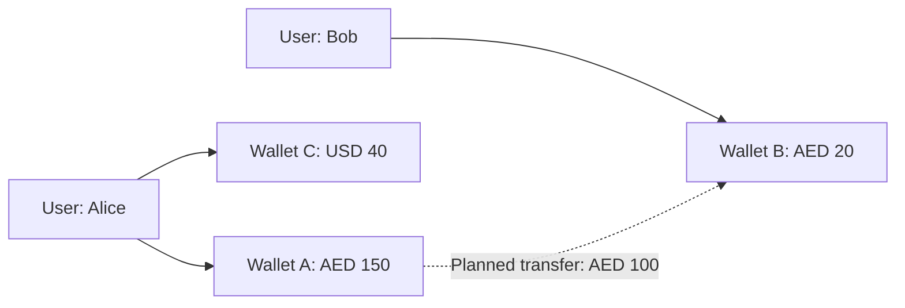

Balances in different currencies remain separate. The dotted arrow is planned money movement.

| Entity | Business meaning | Why it exists separately |
| --- | --- | --- |
| User | The account holder | Identity and authentication should not be duplicated for every currency |
| Wallet | One user's container for one currency | A person may own multiple currencies with independent balances |
| Transaction | A requested money operation and its workflow | A request can be pending or fail without changing money |
| LedgerEntry | A debit or credit associated with an operation | Completed money movement needs an explainable financial record |

A transaction answers **“What operation was requested, and what happened to it?”** A ledger entry answers **“What financial movement was recorded for this wallet?”**

These are different questions. If a payment gateway rejects a top-up, the `topups` record can track the failed funding attempt without a linked financial transaction or any credit to the wallet.

## 3. Table relationships

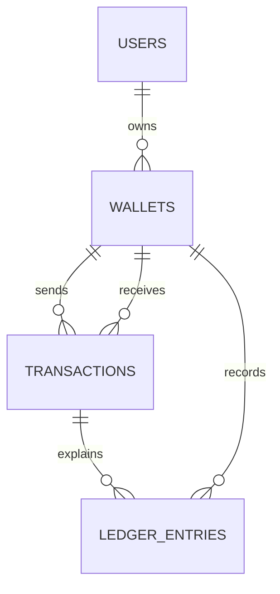

Each line means “one parent can have zero or many children; each child has one parent.” The send and receive lines describe two different roles of a wallet in a transaction.

### User → Wallet: one to many

`wallets.user_id` references `users.id`. Each wallet belongs to exactly one user. A user can have several wallets, but only one for each currency.

Example: user 10 can own wallet 100 in AED and wallet 101 in USD. A second AED wallet for user 10 violates `uq_wallet_user_currency`. Another user can still own an AED wallet.

Registration creates the first AED wallet automatically. The foreign key alone does not enforce “every user has at least one wallet”; that behavior comes from the registration service.

### Wallet → Transaction: two one-to-many relationships

`transactions.sender_wallet_id` and `transactions.receiver_wallet_id` both reference `wallets.id`.

We reference wallets rather than users because money belongs to a specific currency wallet. “Alice sends to Bob” is incomplete: the operation must identify which wallet sends and which wallet receives.

SQLAlchemy needs explicit `foreign_keys` for these relationships because there are two paths to the same table. `sent_transactions` selects the sender role; `received_transactions` selects the receiver role.

**Current limitation:** both wallet references are required. That models an internal transfer naturally, but external top-ups and withdrawals still need a decision about external accounts or nullable references. The model does not yet fully represent those operations.

### Transaction → LedgerEntry: one to many

`ledger_entries.transaction_id` references `transactions.id`. One successful transfer is intended to produce multiple entries: for example, one sender debit and one receiver credit. A pending or failed transaction can have no entries.

The current database allows these relationships but does not enforce that a successful transfer has exactly two entries or that its entries balance. Those are future posting rules.

### Wallet → LedgerEntry: one to many

`ledger_entries.wallet_id` references `wallets.id`. This lets us ask “show every movement affecting wallet 100” without inferring the wallet from the transaction's sender and receiver each time.

An entry therefore references both the operation explaining the movement and the wallet affected by it. Those references serve different purposes.

### Foreign keys versus ORM relationships

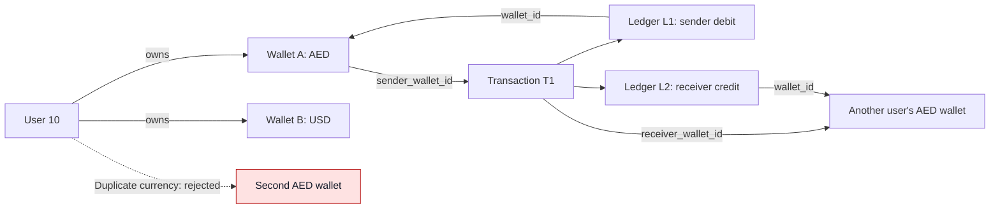

This example connects actual records: each entry points to its transaction and the wallet it affects. The second AED wallet for User 10 is forbidden by the unique user/currency constraint.

A **foreign key** is a database rule: a referenced row must exist. A SQLAlchemy **relationship** is a Python navigation tool, such as `user.wallets` or `wallet.ledger_entries`. `back_populates` connects the two sides of that navigation.

Neither automatically implements ownership authorization, balance rules, or a financial workflow. Deletion and cascade policies also need explicit design; the project has no user/wallet deletion API currently.

## 4. What each table stores and why

### `users`

Source: [user.py](app/models/user.py).

| Field | Purpose and rule |
| --- | --- |
| `id` | Stable internal identity; email and mobile can be business attributes rather than primary keys |
| `username` | Display name; duplicates are allowed because names do not uniquely identify people |
| `email` | Unique account identifier used for login; registration and login lowercase it |
| `mobile` | Another unique identifier; duplicate values are rejected during registration/profile updates |
| `password_hash` | Stores a password hash instead of the original password |
| `date_of_birth` | Stores the supplied date; no age eligibility rule currently uses it |
| `token_version` | Account-wide version compared with access JWTs to invalidate old tokens |
| `created_at`, `updated_at` | Basic creation/modification timestamps; these are not a full audit history |

The API intentionally returns only selected user fields. Password hashes and internal token versions do not belong in profile responses.

### `wallets`

Source: [wallet.py](app/models/wallet.py).

| Field | Purpose and rule |
| --- | --- |
| `id` | Identifies the particular wallet used in requests and transactions |
| `user_id` | Identifies the owner; required foreign key |
| `currency` | AED, USD, or EUR; part of the wallet's identity |
| `balance` | Stored balance, default zero, represented by `Numeric(19, 4)` |
| `status` | `ACTIVE`, `INACTIVE`, or `SUSPENDED`; default `ACTIVE` |
| `created_at`, `updated_at` | Record creation and later updates |

The pair `(user_id, currency)` is unique. Uniqueness on `currency` alone would incorrectly allow only one AED wallet in the entire application. Uniqueness on `user_id` alone would incorrectly prevent multiple currencies per user.

**Why Decimal/Numeric?** Binary floating point cannot represent many decimal fractions exactly. Financial amounts need predictable decimal precision. `Numeric(19, 4)` provides 19 total digits, including four after the decimal point; Python uses `Decimal`. Currency-specific rounding rules still need to be defined.

**Balance rule:** balances must eventually remain non-negative, and changes must go through transaction/ledger operations. Currently there is no direct balance-update endpoint, but there is also no `balance >= 0` database check or implemented posting service.

**Status rule:** status values exist in the model. Restrictions such as “suspended wallets cannot send money” remain planned; an enum alone does not enforce them.

### `transactions`

Source: [transaction.py](app/models/transaction.py).

| Field | Purpose and rule |
| --- | --- |
| `id` | Internal transaction identity |
| `reference` | Unique operation reference; internal transfers generate `TXN-` followed by a full UUID hex value, while external usage is not defined yet |
| `sender_wallet_id`, `receiver_wallet_id` | The wallets participating in the two roles |
| `amount`, `currency` | The requested monetary value and unit |
| `status` | `PENDING` by default; enum also includes `SUCCESS`, `FAILED`, `CANCELLED` |
| `gateway_message` | Optional message associated with a future gateway response |
| `created_at`, `updated_at` | Basic workflow timestamps |

The current transaction table has no operation-type column. Transfer, top-up, and withdrawal types currently appear in the ledger-entry enum. There is also no transaction amount positivity check or same-currency/self-transfer validation yet.

A unique reference prevents duplicate reference values. It does **not** by itself make an endpoint idempotent: an idempotency design must also define how repeated requests find and return the same operation.

### `ledger_entries`

Source: [ledger_entry.py](app/models/ledger_entry.py).

| Field | Purpose and rule |
| --- | --- |
| `id` | Identifies the individual movement record |
| `transaction_id` | Which operation explains the entry |
| `wallet_id` | Which wallet the entry affects |
| `direction` | `DEBIT` or `CREDIT` |
| `entry_type` | `TRANSFER`, `TOP_UP`, `WITHDRAW`, `FEE`, `TAX`, or `CASHBACK` |
| `amount`, `currency` | Positive movement amount and its currency |
| `created_at` | When the entry was created |

The database enforces `amount > 0`. Direction expresses whether money leaves or enters the wallet, rather than mixing signed amounts with a direction field.

In this project's wallet convention, **debit decreases the wallet balance** and **credit increases it**. Full accounting systems classify accounts more precisely; this wallet model is not yet a complete accounting system.

The intended design treats the ledger as financial truth and the wallet balance as a stored value that must agree with it. The transfer service now posts paired entries and updates balances together; no reconciliation job independently checks their agreement. Append-only entries and correcting mistakes through compensating entries are useful future rules, but immutability is not currently enforced.

## 5. Account and authentication business flows

### Registration: create a usable account together

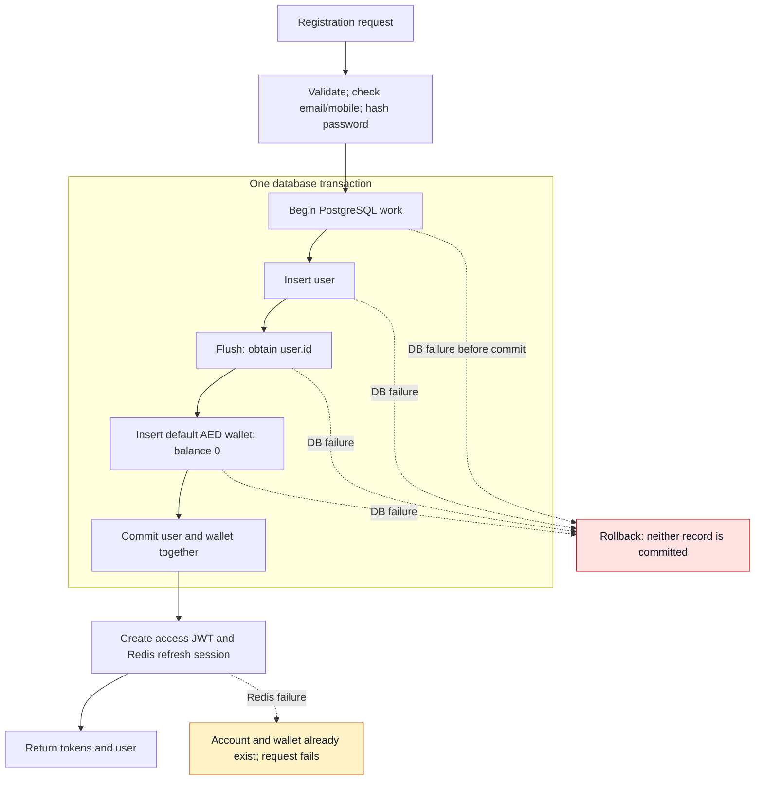

Implemented in [auth_service.py](app/services/auth_service.py).

1. Validate the request schema and lowercase the email.
2. Check that mobile and email are not already registered.
3. Hash the password and create the user.
4. Flush the SQLAlchemy session to obtain `user.id`.
5. Create a zero-balance AED wallet belonging to that user.
6. Commit user and wallet together; roll back if that database work fails.
7. Create an access JWT and a Redis refresh session, then return both tokens and user data.

**Why one database transaction?** A failed wallet insert should not leave a partially registered account. `flush()` sends SQL inside the ongoing transaction; it is not a commit. `commit()` makes both records durable together.

**Boundary to remember:** Redis session creation happens after the database commit. If Redis fails, the account and default wallet may already exist even though registration returns an error. PostgreSQL and Redis are not covered by one shared transaction.

### Login: prove account ownership

The service finds the lowercase email and verifies the supplied password. It returns the same error for a missing email and a wrong password to reduce account enumeration. When the user is missing, it still verifies against a dummy hash to reduce the timing difference; this is not a guarantee of perfectly identical response times.

Each successful login creates a fresh refresh session. “Device session” here means a login session; the code does not identify physical devices or enforce one session per device.

### Protected requests: authentication plus authorization

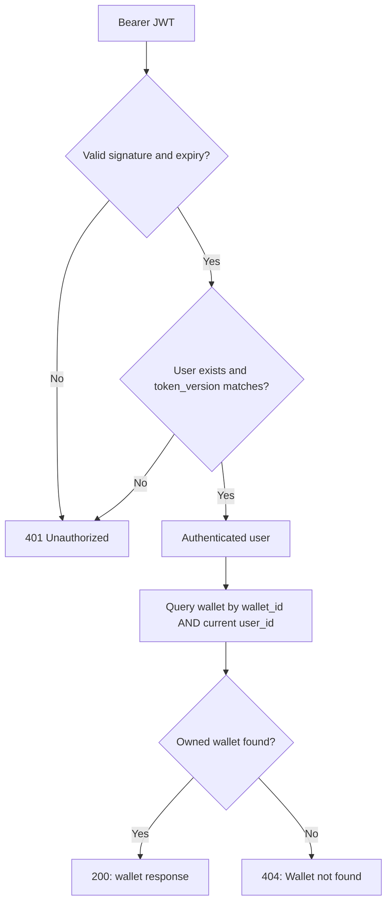

The JWT check establishes identity; the ownership query controls access.

Implemented in [dependencies.py](app/api/routes/dependencies.py).

The dependency extracts the bearer JWT, verifies signature and expiry, loads the user from `sub`, and compares the JWT's `token_version` with the database value. Missing or invalid authentication returns `401`.

**Authentication** asks “Who is making the request?” **Authorization** asks “May that user access this resource?” A valid Alice token establishes her identity; the wallet query must still filter by Alice's user id.

JWT payloads are signed, not encrypted. The signature detects tampering; it does not hide the payload. Sensitive account data should not be placed there.

### Profile updates: change only supplied fields

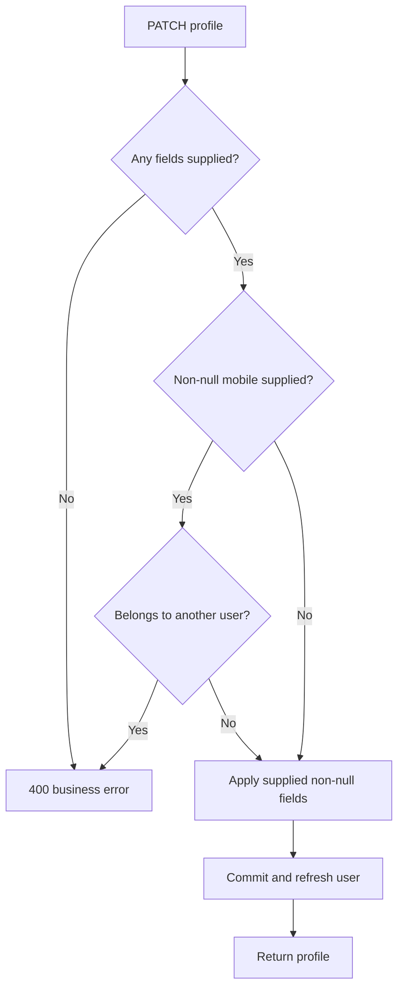

Implemented in [user_service.py](app/services/user_service.py).

The current PATCH endpoint allows `username` and `mobile`. It checks `model_fields_set` so omitted fields stay unchanged. A new mobile must not belong to another user; retaining your own mobile is allowed. The service commits and refreshes the user before returning profile data.

Current details: `{}` is rejected with `400`. Explicit `null` values are ignored, so a request containing only a null field can succeed without changing anything. PATCH fields do not currently reuse all registration length validations. Email and date of birth are not editable through this endpoint.

### Password changes: invalidate old access tokens

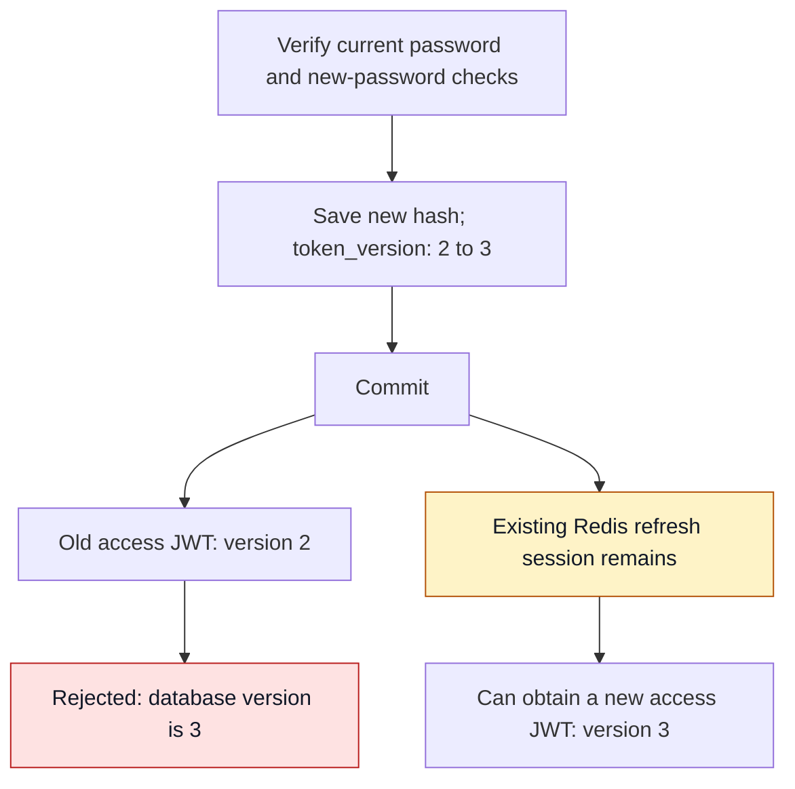

This shows current behavior, including the refresh-session limitation.

The service verifies the current password, requires matching new/confirmation values, and rejects reusing the supplied current password. It then stores the new hash and increments `token_version` in the same database commit.

For example, an old JWT with version 2 stops working when the user record reaches version 3. This invalidates access JWTs across the account.

**Current limitation:** changing the password does not delete Redis refresh sessions. An existing refresh token can still obtain a JWT with the new version. Requiring every device to log in again would need refresh-session revocation as well. New-password strength validation also needs alignment with registration.

## 6. Why access tokens and refresh tokens are separate

An access JWT authorizes normal API calls for a short period (default 30 minutes). A refresh token lets a session obtain new access tokens without asking the user to enter their password repeatedly.

Refresh tokens are random opaque values. Redis stores their SHA-256 hashes and session metadata, rather than usable raw tokens. Passwords use bcrypt because human passwords need a deliberately slow verifier; generated refresh tokens have high random entropy and use a deterministic hash for lookup.

| Redis structure | Job |
| --- | --- |
| `refresh_session:{token_hash}` | Stores one session's JSON with a TTL |
| `user_refresh_sessions:{user_id}` | Set of session hashes used to find all sessions for logout-all |

Session JSON contains `session_id`, `user_id`, and `absolute_expires_at`. Rotation preserves these values while replacing the token and its hash. The stable session identity is different from the changing credential.

### Idle expiry versus absolute expiry

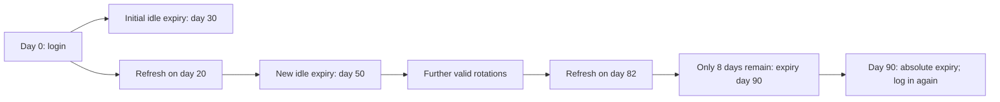

The example uses the default 30-day idle and 90-day absolute limits. Normal protected API calls do not renew the refresh-session TTL.

Default idle expiry is 30 days: an unused refresh session expires. Successful refresh rotation starts a new idle window, capped by the absolute limit.

Default absolute expiry is 90 days from session creation: refreshing must not extend the session forever. The rotated TTL is `min(30 days, time remaining until absolute expiry)`. With only 8 days remaining, the next token gets at most 8 days.

These values are configurable. Initial storage currently applies the idle TTL directly; the refresh service checks absolute expiry and caps rotated TTLs.

### Rotation and concurrent requests

```mermaid
sequenceDiagram
    participant A as Client request 1
    participant B as Client request 2
    participant API as Auth service
    participant R as Redis
    A->>API: Refresh using token A
    B->>API: Refresh using token A
    API->>R: Lua: consume A and store B
    R-->>API: Success: A removed; B indexed
    API-->>A: New access JWT and refresh B
    API->>R: Lua: attempt to consume A again
    R-->>API: Failure: A no longer exists
    API-->>B: 401 Unauthorized
```

The winner can be either request. Even if both read A before rotation, only one atomic consume succeeds.

1. Hash token A and load its session.
2. Check remaining lifetime and that the user still exists.
3. Generate token B with the same session identity and absolute expiry.
4. Run a Lua script that checks A still exists, removes A and its index entry, then stores B and indexes B.
5. Return B and a new access JWT only if rotation succeeded.

**Why Lua?** Two requests might both read A before either deletes it. The script makes the check-and-replace indivisible to other Redis operations. Only one concurrent refresh can consume A successfully.

Reusing A is rejected because A is absent. The implementation does not keep a history distinguishing expired, revoked, and reused tokens, and does not revoke the whole session family when an old token is presented.

### Logout versus logout-all

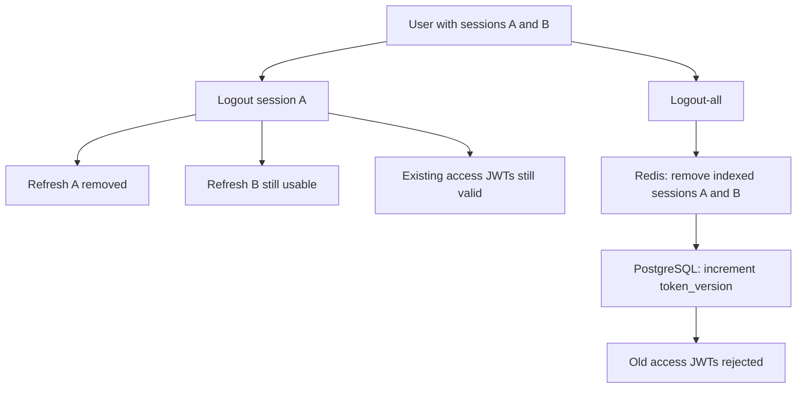

Logout-all's Redis work and PostgreSQL update are separate operations, as described below.

| Action | Refresh sessions | Existing access JWTs |
| --- | --- | --- |
| Logout | Deletes the supplied refresh session | Remain valid until expiry or account-version invalidation |
| Logout-all | Deletes the user's indexed refresh sessions | Invalidated by incrementing `token_version` |
| Change password | Currently remain stored | Invalidated by incrementing `token_version` |

Per-session logout does not increment the account version because that would invalidate access tokens for every other session too.

Logout-all uses Lua so session rotation cannot interleave halfway through enumerating and deleting the user's Redis sessions. This atomicity is limited to Redis: the PostgreSQL version increment is a separate operation, and concurrent new logins are not a globally synchronized part of logout-all.

Current logout expects the client's own refresh token. The implementation deletes the supplied token key without first verifying its session owner; explicit ownership validation is remaining hardening work.

### Why clean stale session hashes?

Redis expires individual session keys automatically, but their hashes can remain in the user's Set. Before storing a new session, the store removes Set members whose session keys no longer exist. This opportunistic cleanup keeps the index useful without requiring a background job in the current MVP.

Redis is authentication-session storage, not financial storage. Losing it removes refresh sessions; financial records remain in PostgreSQL. The current Compose configuration does not persist Redis data in a named volume.

## 7. Wallet business flows

Sources: [wallet routes](app/api/routes/wallet.py), [wallet service](app/services/wallet_service.py), and [wallet repository](app/repositories/wallet_repository.py).

### Create a wallet

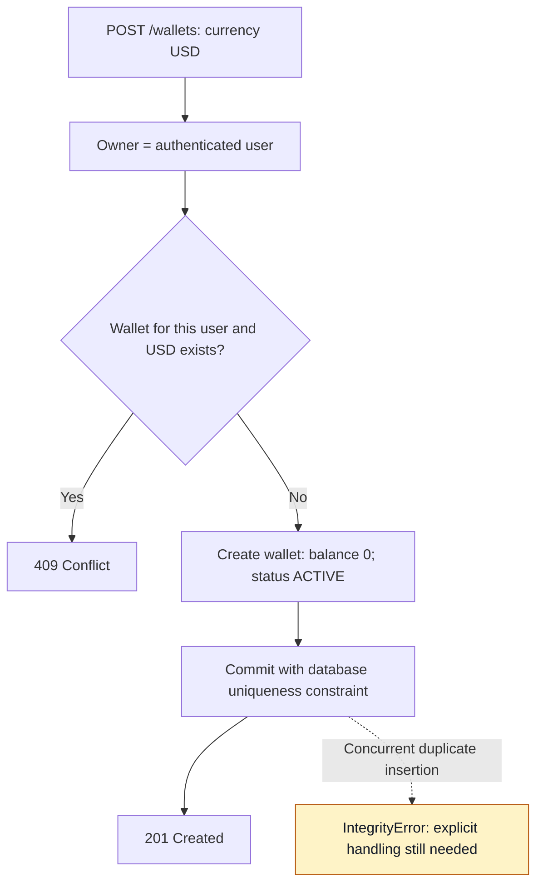

The request supplies only a supported currency. The owner comes from the authenticated user, so the client cannot select a different owner through a `user_id` field.

The service checks `(user_id, currency)`, rejects a detected duplicate, creates the wallet with model defaults, and commits. The endpoint returns `201`; a detected duplicate returns `409`.

**Why both a precheck and a database constraint?** The precheck gives a clear business error. The constraint remains authoritative when two requests race and both prechecks pass. The current code still needs to catch the resulting `IntegrityError` and roll back to consistently return `409` for that race.

### List and view wallets

`GET /wallets` filters by the authenticated user. `GET /wallets/{wallet_id}` filters by both wallet id and authenticated user id.

For an unknown wallet and another user's wallet, the detail endpoint returns the same `404: Wallet not found`. This avoids revealing whether another user's wallet exists.

`WalletResponse` returns `id`, `currency`, `balance`, and `status`. Pydantic's `from_attributes=True` lets it read these values from the ORM object.

## 8. Internal transfers: service flow, examples, and open decisions

### TransferService.transfer(): implementation and flowchart

Source: [transfer_service.py](app/services/transfer_service.py). The service now implements the first fee-free internal-transfer flow. The registered `POST /transfers` route obtains `user_id` from `current_user` and passes it to this service.

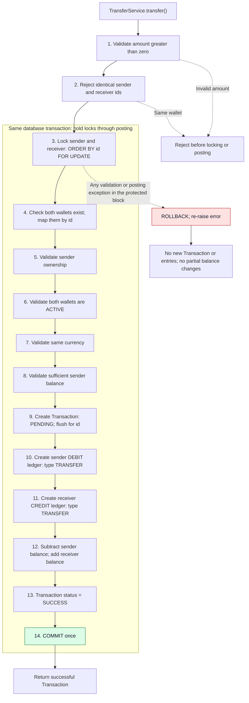

The failure arrow represents exceptions throughout the service's `try` block, not just lock acquisition. A rollback releases the locks and undoes the database transaction's uncommitted changes. `flush()` obtains the transaction id without an intermediate commit.

**Ledger names have different jobs:**

| Attribute | Enum | Values used for a transfer |
| --- | --- | --- |
| `direction` | `LedgerDirection` | Sender `DEBIT`; receiver `CREDIT` |
| `entry_type` | `LedgerEntryType` | `TRANSFER` for both entries |

`LedgerEntryType.DEBIT` and `LedgerEntryType.CREDIT` do not exist. The operation type stays `TRANSFER`; direction tells us which wallet loses or receives money. Both entries also carry the shared currency and link to the generated transaction id.

The service generates a reference using `f"TXN-{uuid4().hex}"`, for example `TXN-7e2ba84f5c164b37a09d638f12c450be`. The prefix makes the reference recognizable as a transaction, while retaining all 32 UUID hex characters. The database's unique constraint enforces uniqueness. The complete reference is 36 characters, so the existing `String(50)` column needs no schema change or migration. Existing references are not rewritten. A future schema change, such as changing a column's length or constraints, requires an Alembic migration.

The service also supplies the transaction currency and maps the optional `message` argument to the existing `gateway_message` field. A distinct user-note field has not been introduced.

**Verification:** local in-memory SQLite checks covered a successful AED 100 transfer, exactly two linked entries with correct directions/types/currency, each business validation, and rollback after flushing a simulated failed posting. These were one-off checks, not a committed automated test suite. They do not verify PostgreSQL row locks or concurrent transfers, and they did not test the HTTP endpoint. Subsequent real HTTP/PostgreSQL checks passed for an AED 150 transfer and seven rejection cases; see [TRANSFER_TEST_RESULTS.md](TRANSFER_TEST_RESULTS.md) for final balances and fixture setup. Amount precision/rounding and idempotency still need work before treating the service as complete.

### First internal-transfer business rules — agreed before coding

These rules define the first simple internal transfer, without fees or currency conversion. They are implemented in the current `TransferService`; see the service flow and verification limits above.

| # | Required rule | Why it matters |
| --- | --- | --- |
| 1 | The amount must be greater than zero | Zero is not money movement; a negative amount could reverse the intended balance effect |
| 2 | The sender wallet must belong to the current authenticated user | Knowing a wallet id must not let someone spend another user's money |
| 3 | Sender and receiver must be different wallets | A transfer must move money between distinct wallets |
| 4 | Sender and receiver must have the same currency | AED cannot be credited as USD; this flow does not perform currency conversion |
| 5 | The sender wallet must be `ACTIVE` | An inactive or suspended wallet must not send money |
| 6 | The receiver wallet must be `ACTIVE` | An inactive or suspended wallet must not receive money |
| 7 | The sender balance must be at least the transfer amount | The transfer must not overdraw the sender; transferring the entire available balance is allowed |
| 8 | Each successful transfer must produce exactly one Transaction, one DEBIT LedgerEntry, and one CREDIT LedgerEntry | One operation explains both sides of the movement, with no missing or duplicate posting |

Both wallets must exist before these checks can succeed. Rule 2 applies to the sender: the receiver can belong to another user. Rule 3 compares wallet ids, not user ids, although the current one-wallet-per-currency constraint prevents a same-user, same-currency transfer between distinct wallets.

For rule 4, the Transaction and both LedgerEntry records must use the wallets' shared currency. For rule 8, both entries must reference that same Transaction, use `entry_type = TRANSFER`, and record the same positive amount. The debit belongs to the sender; the credit belongs to the receiver. Both balance updates and the success posting must commit together, as illustrated below.

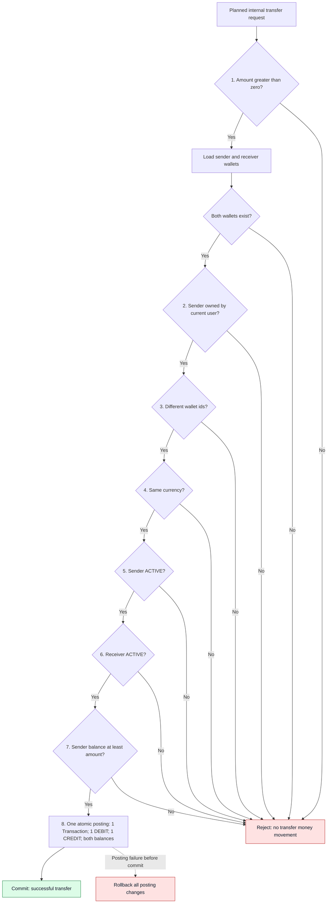

This diagram explains the business decisions; it does not prescribe separate unlocked queries. Balance and status checks must remain valid through posting, using appropriate concurrency protection within the database transaction. The API error codes for these future transfer validations have not been selected yet.

### Agreed first-transfer flow: one commit at the end

The `POST /transfers` endpoint authenticates the caller and delegates the operation to `TransferService`. This first internal-transfer flow does not wait for an external gateway. Both the service and endpoint are implemented, with sequential integration results recorded separately.

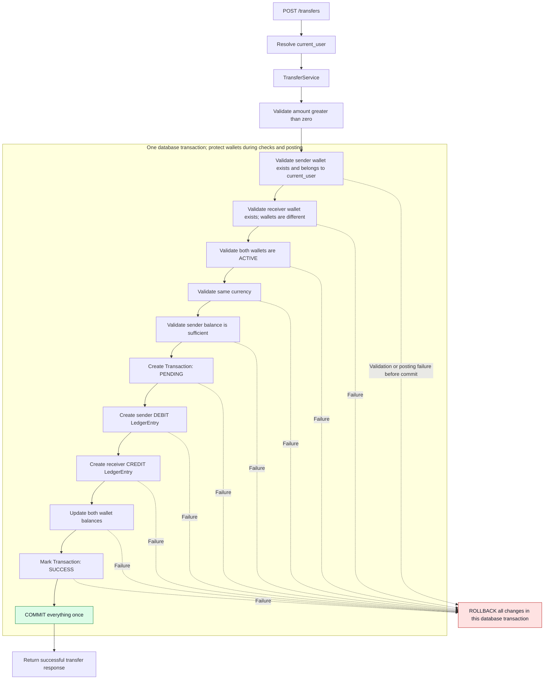

Here, **DEBIT sender / CREDIT receiver means creating the two ledger entries**. Updating the stored wallet balances is the following step: subtract the amount from the sender and add the same amount to the receiver. This distinction prevents accidentally applying the balance change twice.

`PENDING` is an intermediate state inside this same uncommitted operation. There is no commit after creating it. If the service needs the generated transaction id for the entries, it can `flush()` without committing. After successful completion, the committed record is `SUCCESS`. A rollback removes the newly created transaction and entries and reverses the balance changes together.

The service coordinates the single commit; repository methods must not commit individual steps. Concurrency protection must cover the wallet checks and balance updates so another request cannot spend funds between validation and posting. Authentication may already have started work on the request's SQLAlchemy Session, so implementation must account for that existing transaction rather than blindly starting a nested or conflicting one.

The atomicity diagram below illustrates the same all-or-nothing rule; its conceptual grouping of balance and ledger writes does not introduce extra commits. The agreed sequence for the first service is the one shown here. External operations that commit a pending request before waiting on a gateway are a separate future workflow.

### Worked example: transfer AED 100

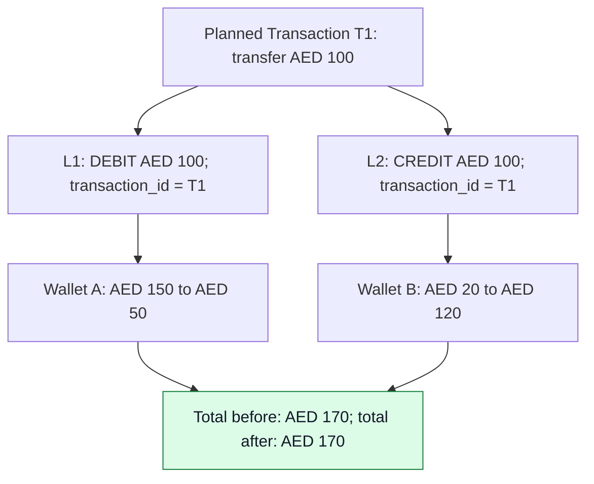

One transaction explains both entries. Each entry changes one wallet; the fee-free internal transfer conserves the total AED amount.

Suppose Alice owns Wallet A with AED 150, and Bob owns Wallet B with AED 20. Alice requests an AED 100 internal transfer without fees. The following records illustrate the result of a successful service call; the separate live API report uses AED 150 and records the actual test wallets. `T1`, `L1`, `L2`, `A`, and `B` are readable labels standing in for actual database ids.

```text
Transaction T1
sender_wallet_id = A
receiver_wallet_id = B
amount = 100
currency = AED
status = SUCCESS
```

The transaction explains the operation. Its ledger entries explain each wallet's movement:

```text
LedgerEntry L1
wallet_id = A
direction = DEBIT
entry_type = TRANSFER
amount = 100
currency = AED
transaction_id = T1

LedgerEntry L2
wallet_id = B
direction = CREDIT
entry_type = TRANSFER
amount = 100
currency = AED
transaction_id = T1
```

The model calls debit/credit **`direction`**, while **`entry_type`** describes the business operation, such as `TRANSFER`. Both entries have a positive amount; direction determines the balance effect.

The core relationship is:

```text
One Transaction
    └── Many Ledger Entries

Simple internal transfer without fees:
    ├── DEBIT the sender
    └── CREDIT the receiver
```

A simple internal transfer should produce exactly two entries. The relationship stays one-to-many because other operations or future fee accounting may need a different number of entries.

The intended successful result is:

| Record | Expected result |
| --- | --- |
| Transaction T1 | AED 100, Wallet A → Wallet B, `SUCCESS` |
| Alice's ledger entry L1 | `DEBIT`, AED 100, `TRANSFER` |
| Bob's ledger entry L2 | `CREDIT`, AED 100, `TRANSFER` |
| Alice's stored balance | AED 150 − AED 100 = AED 50 |
| Bob's stored balance | AED 20 + AED 100 = AED 120 |

The pair conserves AED value in this simplified internal transfer. Future fees need explicit additional accounting; they must not be unexplained differences between balances.

The first eight transfer rules are defined above and implemented in the service. Idempotency and permitted status transitions also need explicit design before retries and workflow transitions are supported.

### Required rule: commit the entire transfer together

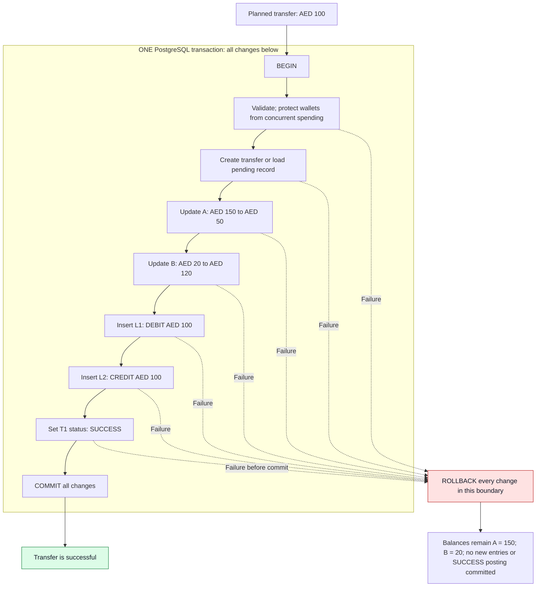

Arrows show the planned coordination, not separate commits. A previously committed pending record remains after rollback; the changes in this posting boundary are what roll back.

**A transfer must not be considered successful unless the successful Transaction record, both LedgerEntry records, and both wallet balance updates are committed in the same database transaction.**

Here, a business `Transaction` is an application record. A **database transaction** is the all-or-nothing boundary surrounding several database changes. They are different meanings of the same word.

```text
BEGIN database transaction
    Validate and protect the wallets against concurrent spending
    Create the transfer record, or update an existing pending record
    Debit Wallet A by AED 100
    Credit Wallet B by AED 100
    Insert debit LedgerEntry L1
    Insert credit LedgerEntry L2
    Mark Transaction T1 as SUCCESS
COMMIT everything together

If any step fails before commit:
    ROLLBACK every change in this database transaction
```

The following partial outcomes must never be committed:

| Partial outcome | Why it breaks the business rule |
| --- | --- |
| A is debited, but B is not credited | Money leaves the sender without reaching the receiver |
| Ledger entries are written, but balances are not updated | Stored balances disagree with recorded movements |
| Balances change, but ledger entries are missing | Money moves without the records explaining it |
| T1 is marked `SUCCESS`, but another posting step fails | The workflow reports success for incomplete movement |

If a pending transaction was committed earlier, rollback of the final posting does not erase that earlier record. It must leave no partially committed success posting; failure/retry handling for the pending record needs its own policy.

### Lock ordering: why sort wallet ids before FOR UPDATE?

The repository's `get_wallets_for_update(wallet_ids)` now selects the matching wallets with `.order_by(Wallet.id).with_for_update()`. The transfer service uses this query and keeps validation and posting in the same database transaction.

Without consistent ordering, opposite-direction transfers can each hold the row the other needs:

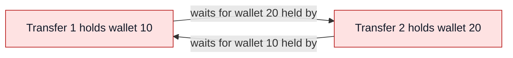

That cycle is a deadlock. Sorting by the stable wallet id makes both transfers request rows in the same order, regardless of which wallet is the sender:

```mermaid
sequenceDiagram
    participant T1 as Transfer 1: 10 to 20
    participant W10 as Wallet 10
    participant W20 as Wallet 20
    participant T2 as Transfer 2: 20 to 10
    T1->>W10: Acquire row lock
    T2->>W10: Request row lock; wait here
    Note over T2,W20: Transfer 2 has not locked wallet 20
    T1->>W20: Acquire row lock
    Note over T1: Validate and post within the transaction
    T1->>W10: Commit releases lock
    T1->>W20: Same commit releases lock
    W10-->>T2: Waiting lock can now be acquired
    T2->>W20: Acquire row lock
    Note over T2: Validate against current balances, then post
```

The diagram illustrates a case where Transfer 1 acquires wallet 10 first; either transfer can win. All transfer paths must follow the same ascending-id lock protocol. This reduces deadlock risk for these wallet rows, but does not guarantee the entire application is deadlock-free: other rows, tables, or differently ordered queries can still introduce cycles. The locks last until commit or rollback, not just until the repository method returns.

### Why does the locking query return a list?

The query matches a set of wallet ids, so it can return several Wallet objects:

```text
wallet_ids = [20, 10]
    ↓ WHERE id IN (...) + ORDER BY id + FOR UPDATE
matching locked rows: Wallet 10, Wallet 20
    ↓ db.scalars(stmt).all()
collection of Wallet ORM objects
    ↓ list(...)
list[Wallet], ordered as [Wallet 10, Wallet 20]
```

`scalars()` exposes the Wallet objects for all result rows. `scalar()` would return only the first result and would not provide both wallets to the service. `.all()` collects the results; wrapping them in `list()` makes the return type explicit. It does not create detached copies, and returning the list does not release row locks.

**Never assume `wallets[0]` is the sender.** Results are sorted by id, not by the request's roles or input order. The future service should find the sender and receiver by their ids, for example through a dictionary keyed by `wallet.id`, then validate ownership and the other rules.

Missing wallet ids are omitted, so a two-wallet request may return fewer than two rows. Repeating an id does not return the same row twice. The caller must check existence and distinct ids explicitly; the list alone does not prove that a valid transfer can proceed.

### Next implementation step

Add authenticated transaction and ledger history endpoints, define amount precision, and add repeatable PostgreSQL tests for posting, rollback, and concurrent opposite-direction transfers. Add idempotency before supporting retries. The current service is a first implementation, not a fully verified transfer API.

### Why pending is different from success

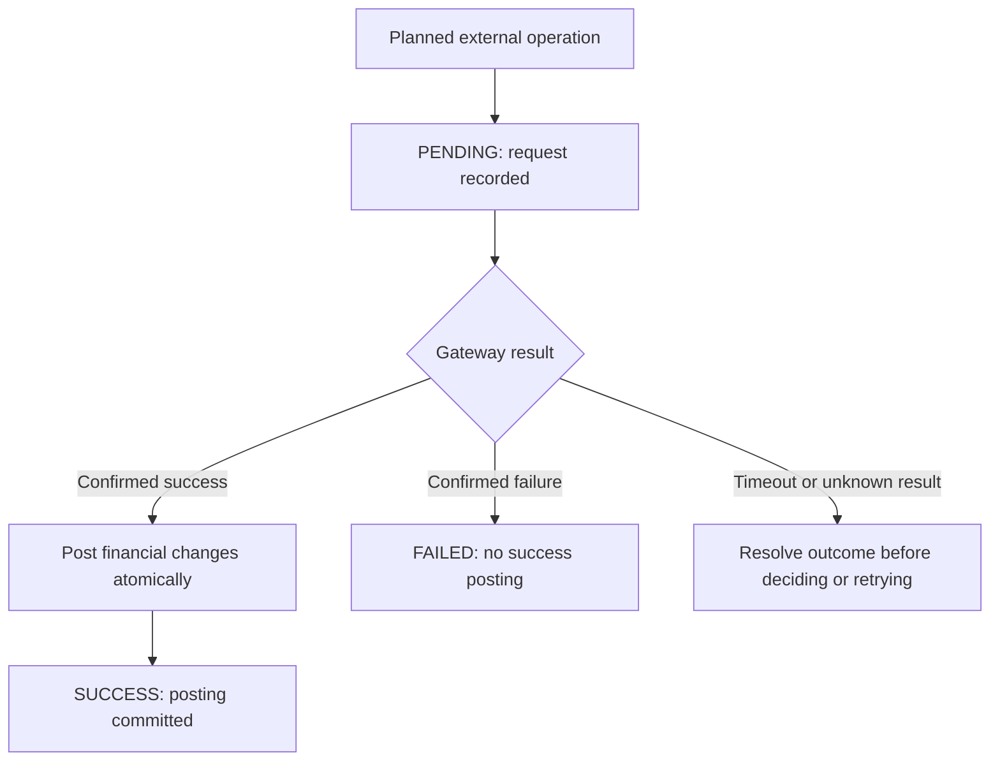

This is the intended external workflow, not an implemented state machine. Cancellation and unknown-outcome policies still need design.

The planned external-operation flow is `PENDING → gateway result → SUCCESS or FAILED`. Recording the request is different from confirming money movement. The status enum also has `CANCELLED`, but cancellation rules and transition enforcement do not exist yet.

An external network request should not hold database locks indefinitely. Earlier design notes propose releasing locks after pending creation, then waiting for the gateway. That decision still needs a complete funds-reservation/revalidation strategy.

For example, Alice has AED 100 and requests two pending transfers of AED 80. Both can pass a balance check before either completes. Row locks used only during pending creation do not reserve AED 80 for the first request. A safe implementation must define reservations/holds or another concurrency protocol, including what happens when external success has already occurred.

Gateway callbacks may arrive more than once. A future posting service must detect an already-applied operation so a repeated callback cannot credit money twice. Gateway failures, timeouts, retries, and reconciliation also need explicit policies.

## 9. Why the code has these layers and tools

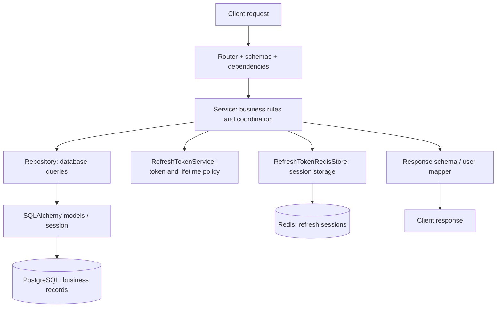

The branches show responsibilities, not one database transaction across both stores. Wallet services use PostgreSQL; authentication also coordinates refresh-token policy and Redis storage.

| Component | Responsibility | Reason in this project |
| --- | --- | --- |
| Router | HTTP input, dependencies, response schemas, status codes | Keeps transport decisions at the API boundary |
| Schema | Request validation and public response shape | Controls what the client can send and see |
| Service | Business checks and operation coordination | Makes rules readable without mixing them into route handlers |
| Repository | Database queries and adding ORM entities | Centralizes queries such as ownership filtering |
| Model | Tables, columns, constraints, relationships | Expresses persisted structure and database-enforced rules |
| Mapper | Selects user response fields | Keeps internal fields out of public responses |
| Redis store | Session persistence and atomic Redis scripts | Separates storage mechanics from token lifetime policy |
| FastAPI / Depends | Routing and dependency wiring | Supplies the current user and request database session consistently |
| SQLAlchemy Session | Coordinates database work | Allows related changes to commit or roll back together |
| PostgreSQL | Durable relational records | Stores users, wallets, transactions, ledger entries, and constraints |
| Alembic | Versioned schema changes | Evolves an existing database as the models change |
| Redis | Expiring session records and atomic rotation | Supports TTL and efficient session revocation |
| Pydantic Settings | Central configuration | Keeps environment-specific values separate from business logic |
| Docker Compose | Starts local PostgreSQL and Redis | Makes the local infrastructure reproducible |
| uv | Python environment and dependency management | Helps install the project's declared dependencies consistently |

Typical path: **request → schema/dependencies → router → service → repository/model → database → response schema**. Authentication also uses the Redis store.

The service currently raises `ValueError`; routers translate that into HTTP errors. Database exceptions are different and still need appropriate handling. Response validation happens after service execution, so a response-schema error does not undo an already committed operation.

`get_db()` creates a session for the request and closes it afterward; services decide when to commit. Closing a session is cleanup, not proof that the business operation succeeded. ORM model changes also do not update existing tables automatically: Alembic migrations do that.

The current migrations create the initial tables, allow duplicate usernames, and add `token_version`. They record schema evolution, not a history of individual financial operations.

### Execution review: def, async def, and the thread pool

Reviewed on **October 28, 2026**. The project's SQLAlchemy `Session` is still
synchronous; moving work to a thread does not turn it into async database I/O.

| Code | Execution choice | Reason |
| --- | --- | --- |
| Wallet, transfer, transaction, ledger, and user endpoints | `def` | FastAPI executes synchronous endpoints in its thread pool |
| Authentication endpoints and their orchestration methods | `async def` | They await the async Redis store |
| Authentication SQLAlchemy work and password hashing/verification | Sync helpers awaited through `run_in_threadpool` | Prevent database waits and bcrypt work from occupying the event-loop thread |
| Redis store and Redis health check | `async def` | The Redis client supports awaitable I/O |
| Basic health response | `async def` | Returns a small dictionary without blocking work; no thread is needed |
| Application lifespan | `async def` | Awaits Redis client cleanup |

```mermaid
flowchart TD
    R["Request"] --> K{"Which endpoint?"}
    K -->|Synchronous SQLAlchemy only| D["def endpoint"]
    D --> W["FastAPI thread pool: service and repository"]
    W --> DB["Worker waits for synchronous database result"]
    K -->|Authentication with async Redis| A["async def endpoint"]
    A --> H["await run_in_threadpool: SQLAlchemy / bcrypt helper"]
    H --> BACK["Return to async orchestration"]
    BACK --> REDIS["await Redis I/O on the event loop"]
    DB --> OUT["Return response"]
    REDIS --> OUT
```

The diagram is simplified: refresh reads Redis before loading the user, while
logout-all revokes Redis sessions before updating the database token version.
Each synchronous helper is awaited before another operation uses the same
request Session. The Session must not be shared by simultaneous tasks.

An ordinary `def` service called directly from `async def` does not get a worker
automatically. The authentication service therefore offloads its synchronous
helpers explicitly. It also serializes ORM user data in a worker because reading
attributes expired by `commit()` can trigger another database query. The async
orchestrator returns response-schema data after awaiting Redis.

This keeps one request waiting for its own result while letting the event loop
serve other work. Thread-pool and database-pool capacity remain finite. No
database schema changed, so no Alembic migration is required.

Verification: seven automated execution-boundary tests assert worker-thread
database/password work, Redis awaits, route execution modes, and registration
rollback. Live checks covered 25 authentication/endpoint scenarios plus 13
existing-wallet/ledger/transaction scenarios. A new test user (id 5) has a
zero-balance AED wallet; existing wallet balances remain AED 350 and AED 250.
These tests verify behavior and execution placement, not a throughput benchmark.

Run the automated tests with the project environment:

```bash
DEBUG=false .venv/bin/python -m unittest discover -s tests -v
```

References: [FastAPI execution behavior](https://fastapi.tiangolo.com/async/#path-operation-functions)
and [SQLAlchemy's separate async API](https://docs.sqlalchemy.org/en/20/orm/extensions/asyncio.html).

## 10. API map: business action to current response

The table lists normal success and selected business errors. Schema validation can also return `422`; protected routes require valid authentication.

| Endpoint | Business action | Current outcomes |
| --- | --- | --- |
| `POST /auth/register` | Create user, default AED wallet, and session | `201`; detected duplicate email/mobile → `400` |
| `POST /auth/login` | Verify credentials and create session | `200`; invalid credentials → `400` |
| `POST /auth/refresh` | Consume refresh token and issue replacements | `200`; invalid/expired/consumed token → `401` |
| `POST /auth/logout` | Revoke the supplied refresh session | `204` |
| `POST /auth/logout-all` | Revoke indexed sessions and invalidate access JWTs | `204` |
| `GET /users/me` | View your profile | `200` |
| `PATCH /users/me` | Update supplied profile fields | `200`; empty request or detected mobile conflict → `400` |
| `POST /users/me/change-password` | Change password and access-token version | `200`; password business checks fail → `400` |
| `POST /wallets` | Create your wallet for a currency | `201`; detected duplicate → `409` |
| `GET /wallets` | List your wallets | `200` |
| `GET /wallets/{wallet_id}` | View one wallet you own | `200`; absent or owned by another user → `404` |
| `GET /health` | Basic service health endpoint | See [health.py](app/api/routes/health.py) for its current check |

## 11. Questions to ask when adding the next feature

1. What business event are we recording, and who is allowed to trigger it?
2. Which rules belong in request validation, service logic, and database constraints?
3. Which records must change together in one transaction?
4. What happens if two requests arrive at the same time?
5. What happens if a client retries or an external callback repeats?
6. If PostgreSQL succeeds but Redis or a gateway fails, what state remains?
7. Can a user infer or access another user's data?
8. Which automated test would demonstrate the rule and its failure case?

Use [PROGRESS.md](PROGRESS.md) for the implementation checklist. Update this guide whenever a new business rule is implemented or an existing decision changes, keeping the distinction between intended behavior and actual behavior explicit.

## Safe API error messages

Only `BusinessError` carries a message deliberately written for the client. A normal
`ValueError` could originate in a library and contain implementation details, so
routes must not automatically expose it. Internal failures return a generic 500.

```mermaid
flowchart TD
    Request[API request] --> Valid{Request fields valid?}
    Valid -->|No| Invalid[422: field and reason, without submitted input]
    Valid -->|Yes| Service[Run service]
    Service --> Business{Expected business failure?}
    Business -->|Yes| Safe[Return safe message and appropriate status]
    Business -->|No: unexpected exception| Internal[500: generic message; server retains exception]
    Business -->|No error| Success[Return successful result]
```

Examples: `Insufficient balance` concerns the authenticated sender's own wallet,
so it is useful. Receiver status and currency failures use `Wallet unavailable for
this transfer`, which avoids describing another user's wallet. Missing and
unauthorized wallet/transaction reads continue to share a not-found response.

Registration duplicates now share a message instead of naming the existing email
or mobile. This alone does **not** prevent account enumeration: different success
and failure outcomes can still reveal whether details are usable. Stronger
protection requires designing contact verification and abuse controls together.

## Why does wallet funding need a TopUp model?

**A TopUp is specifically a request to add money to a wallet through Moyasar.**
An internal transfer between two existing wallets does not create a TopUp.

| Table | Business responsibility |
| --- | --- |
| `topups` | Track the wallet funding request, its Moyasar Payment ID, and its PENDING / COMPLETED / FAILED status. |
| `transactions` | Record the financial operation inside Nexa. |
| `ledger_entries` | Record how that financial operation affects wallet balances: DEBIT or CREDIT. |

### Example: add 100 AED to a wallet

Suppose Wallet A starts with 50 AED. The user requests a 100 AED top-up.
With two decimal places for AED, `amount_minor = 10000` represents 100 AED.

```text
TopUp TU1: request to fund Wallet A with 100 AED
    status = PENDING
    transaction_id = None
    Wallet A balance is still 50 AED
                |
                v
    Verify the payment result and match it to TU1
                |
        +-------+-------+
        |               |
      Failed         Successful
        |               |
        v               v
TopUp = FAILED     Post the financial operation once
No wallet credit      |
Balance = 50 AED      +--> Transaction T1: Nexa financial record
                      +--> Ledger CREDIT: Wallet A, 100 AED, type TOP_UP
                      +--> Wallet A balance: 50 -> 150 AED
                      +--> TopUp TU1: COMPLETED, transaction_id = T1
                      |
                      v
             Commit all posting changes together
             Any posting failure -> roll back those changes
```

The diagram shows the intended business flow. It does not define the complete
accounting entries: the current Transaction model requires both sender and
receiver wallets, so the external funding/counterpart representation must be
resolved before implementing top-up posting. A repeated payment notification
must not credit the wallet again.

`TopUp.transaction_id` is nullable because a pending or failed request may not
have a financial transaction. Its unique constraint prevents two TopUps from
linking to the same transaction. One linked Transaction can have multiple ledger
entries; they explain its balance effects.

**Current implementation:** the TopUp model and its migration file exist. The
webhook currently verifies the secret, rejects live events, logs metadata, and
acknowledges receipt. It does not yet save/process TopUps or credit wallets.
