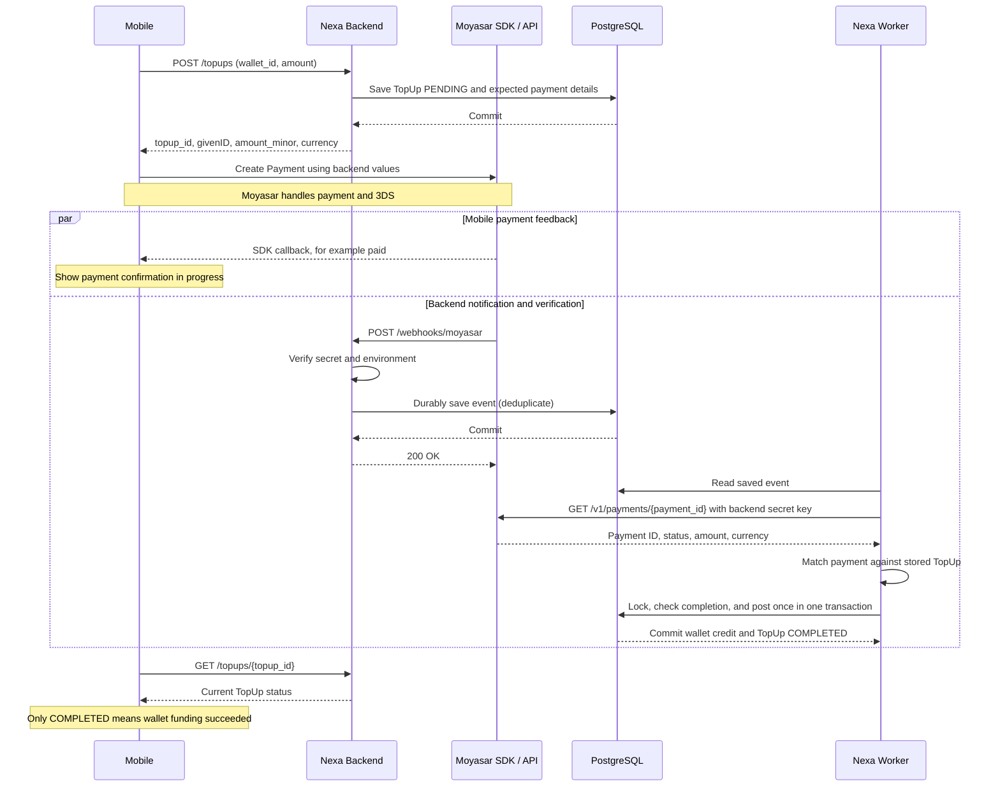

# Nexa Wallet — Moyasar TopUp Flow

Business reference agreed on **2026-11-07**. This describes the intended complete
flow; the implementation checklist below distinguishes existing code from planned work.

**The backend is the source of truth for wallet credit.** A `paid` result from the
Moyasar SDK describes payment progress; only Nexa's `COMPLETED` TopUp means that
Nexa has committed the wallet credit.

For a beginner-friendly explanation of the worker, processor, and every model, see
[Worker and TopUp Models](MOYASAR_WORKER_GUIDE.md).

## Table responsibilities

| Table | Responsibility |
| --- | --- |
| `topups` | Track a request to fund a wallet through Moyasar, including the expected payment ID, amount, currency, and final result. |
| `transactions` | Record the financial operation inside Nexa. |
| `ledger_entries` | Record the operation's effect on wallet balances. |
| `moyasar_webhook_events` | Durably record incoming notifications and their processing state so a worker can retry after a failure. |

A TopUp is only for adding funds to a wallet. An internal wallet-to-wallet
transfer does not create a TopUp. Creating a PENDING TopUp does not change a balance.

## Complete flow



The callback and webhook can arrive in either order. Backend processing must
continue even if the user closes the app or never receives the SDK callback.

## Step 1 — Mobile → Nexa Backend: create the funding request

The authenticated mobile client calls `POST /topups` with `wallet_id` and `amount`.
The backend checks wallet ownership, ACTIVE status, supported currency, and a
valid positive amount. It saves a TopUp with status `PENDING`, generates a
`givenID`, and stores the expected amount and currency before responding.

The mobile receives `topup_id`, `givenID`, `amount_minor`, and `currency`.
These business names map to the current response as follows:

| Business / SDK name | Current API response field | Meaning |
| --- | --- | --- |
| `topup_id` | `id` | Nexa's UUID for the funding request. |
| `givenID` | `moyasar_payment_id` | Backend-generated UUID passed to the SDK to identify the expected payment. |
| `amount_minor` | `amount_minor` | Integer amount in the smallest currency unit. |
| `currency` | `currency` | The wallet's currency, recorded by the backend. |

For the AED example, 100 AED becomes `10000` minor units. The mobile must use the
backend's returned values. This example does not establish which currencies are
enabled for a particular Moyasar account.

## Step 2 — Mobile → Moyasar SDK: perform payment

The mobile creates the payment through the Moyasar SDK using `givenID`, amount,
and currency returned by Nexa. Moyasar handles payment and 3DS and returns a
callback such as `paid`.

**`paid` in this callback does not mean that Nexa has credited the wallet.**
The mobile shows payment progress and checks the TopUp status with Nexa. It must
not add money to the displayed wallet balance based only on the SDK callback.

## Step 3 — Moyasar → Nexa Backend: receive and save the webhook

Moyasar sends a notification to `POST /webhooks/moyasar`. The backend verifies
`secret_token`, checks the allowed environment, and saves the event durably in
PostgreSQL before returning `200 OK`.

```text
Receive webhook
    ↓
Verify secret and environment
    ↓
Save event / recognize an already saved Event ID
    ↓
COMMIT event storage
    ↓
200 OK: notification safely received, not necessarily processed
```

If saving fails, do not acknowledge successful receipt. An in-memory task or a
log line alone cannot protect the event from a server crash after the response.
Persist the information needed for processing; do not persist or log the webhook
secret or unnecessary card details.

## Why fetch the payment again?

| Approach | Before crediting the wallet |
| --- | --- |
| Use the webhook directly | Authenticate it, match payment ID/amount/currency to the TopUp, and prevent duplicate credit. |
| **Nexa's chosen design** | Save the authenticated event, then independently fetch and verify the payment through the worker. |

The second approach adds an independent server-side check using the backend API
secret key. Both approaches still need validation and protection against duplicates.

```text
Webhook → verify secret → save + COMMIT → 200 (safely received)
                              ↓
                    Worker → GET payment → verify → credit once
```

**200 means the event was saved, not that the wallet was credited.** If saving
fails, return an error so delivery can be retried. The worker must also retry
temporary failures after receipt. `GET /payments/{id}` only reads an existing
payment; it does not create a payment or charge the customer again.

## Step 4 — Nexa Worker → Moyasar API: verify the payment

The worker reads a saved event and fetches the payment from:

```text
GET https://api.moyasar.com/v1/payments/{payment_id}
```

In the test environment, the `sk_test_...` credential stays on the backend only.
It must not be sent to the mobile. The webhook secret and the API secret key have
different jobs: one authenticates the notification; the other authorizes the
backend's request to Moyasar.

### Why use httpx?

`httpx` is a Python HTTP client: our backend uses it to send requests and read
responses from other services. It works with any compatible HTTP API, including
Moyasar, public APIs, and APIs provided by open-source projects. Each service
defines its own URL, authentication, and request format.

```text
External caller → FastAPI receives requests in Nexa
Nexa → httpx sends requests → External API → response back to Nexa
```

Here, httpx will fetch the existing Moyasar payment for verification. Installing
the library alone does not send requests; our code must call it.

Before crediting a wallet, compare the fetched result with the stored TopUp:

| Check | Required result |
| --- | --- |
| Payment ID | Matches the TopUp's expected `moyasar_payment_id`. |
| Payment status | `paid`. |
| Amount | Exactly matches `amount_minor`, using minor units on both sides. |
| Currency | Exactly matches the stored currency. |

Do not use webhook fields or mobile callback data alone as proof of payment.
A network timeout is not proof that payment failed: retain the event for retry
without crediting the wallet. Conflicting payment details require review rather
than an automatic credit. An unmatched event also needs investigation without
modifying an unrelated TopUp.

## Step 5 — Nexa Backend → PostgreSQL: credit once, atomically

After verification, use one database transaction for the financial posting:

```text
Begin DB transaction
    ↓
Lock TopUp and Wallet in a consistent order
    ↓
Recheck TopUp state and the stored payment details under the lock
    ├── Already COMPLETED → no additional credit
    ├── Conflicting details → no credit; REVIEW_REQUIRED
    └── Eligible for posting
              ↓
       Create Transaction SUCCESS
              ↓
       Create LedgerEntry: TOP_UP / CREDIT
              ↓
       Increase Wallet balance
              ↓
       Link TopUp.transaction_id and mark COMPLETED
              ↓
       COMMIT all posting changes together

Any posting failure → ROLLBACK all those changes
```

Example: Wallet A starts at 50 AED. A verified 100 AED TopUp changes it to
150 AED. Receiving the same event twice, or receiving different events for the
same payment, must leave the balance at **150 AED**, not 250 AED.

Event deduplication and financial idempotency are separate protections. A unique
Event ID prevents duplicate event storage; locking and checking TopUp completion
prevents the same payment from being credited twice. Worker retries after a
crash must use the same safeguards.

For a mismatch, the `REVIEW_REQUIRED` state means **no wallet credit**
and a need for investigation or a possible refund. It does not mean a refund has
already happened.

**Current accounting representation:** external funding uses
`Transaction.sender_wallet_id=None` and a CREDIT entry for the receiving wallet.
This records the customer's wallet effect; it does not define a complete
counterpart accounting design.

## Step 6 — Mobile → Nexa Backend: check the final result

After the SDK callback, the authenticated mobile calls `GET /topups/{topup_id}`.
Only the owner can read the TopUp; another user's ID should return the same
not-found response as a missing ID.

| Nexa status | Meaning | Mobile behavior |
| --- | --- | --- |
| `PENDING` | Payment or backend confirmation is still in progress. | Poll for a limited period; keep a pending message if confirmation takes longer. |
| `COMPLETED` | The wallet credit has committed. | Show wallet TopUp success and refresh the wallet balance. |
| `REVIEW_REQUIRED` | A discrepancy needs investigation; no credit was posted. | Show a review message, not wallet TopUp success. |
| `FAILED` | A confirmed unsuccessful funding attempt. | Show failure; do not change the wallet balance. |

A polling timeout does not make a payment FAILED. If the app closes, the backend
continues processing. When the app opens again, it fetches the latest TopUp state.

## Current implementation and next steps

Source reviewed on **2026-11-07**; this is a code inventory, not a new integration test.

| Step | Current state |
| --- | --- |
| 1 — Create TopUp | Model, migration, POST route, ownership checks, amount conversion, and PENDING persistence exist. |
| 2 — Mobile SDK | Backend response fields exist; SDK/3DS integration is outside the Python code reviewed here. |
| 3 — Receive webhook | Authenticated sandbox payment_paid events are saved and committed in moyasar_webhook_events before 200. Duplicate Event IDs are skipped; other event types return 200 with ignored=true without storage. |
| 4 — Worker verification | Worker, scheduled HTTP/invalid-response retries, payment lookup, and payment-ID mismatch review exist. Startup rejects placeholder keys; retries still have no terminal limit. |
| 5 — Financial posting | Processor posts transaction, ledger credit, wallet balance, TopUp completion, and event completion together. REVIEW_REQUIRED and nullable sender migrations are applied. Wallet ACTIVE status is rechecked under its row lock before posting. |
| 6 — Status lookup | Owner-scoped GET route exists. Mobile polling and final UI handling still need integration. |

## Convention for the next code steps

For every implementation step, place a short **English business explanation and
flowchart immediately above the relevant function** (before its decorator, if
present). Keep function names simple, preserve the charts, and connect the code
to the numbered step in this reference. Add short inline comments for individual
checks where they help a new reader.

Example of the style to use when durable receipt is implemented:

```python
# Business — Step 3: acknowledge only after the event is safely stored.
# Verify secret -> save/deduplicate event -> COMMIT -> return 200
# If saving fails, do not return a successful acknowledgement.
```

Comments must describe what that function actually implements; label future
behavior as planned until the code and its checks exist.
