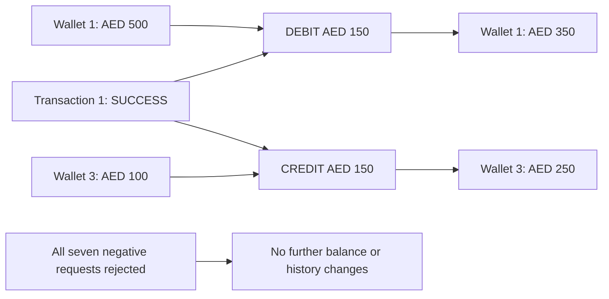

# Transfer API verification — October 25, 2026

Executed real HTTP requests against local FastAPI, PostgreSQL 16, and Redis 7.
The transfer router existed but was not included in `app/main.py`; it is now
registered so `POST /transfers` is available.

## Test accounts and final balances

| Role | User id | Wallet id | Currency | Starting balance | Final balance | Final status |
| --- | --- | --- | --- | --- | --- | --- |
| A — existing user | 1 | 1 | AED | 500.0000 | **350.0000** | ACTIVE |
| B — newly registered test user | 3 | 3 | AED | 100.0000 | **250.0000** | ACTIVE |
| B — currency-mismatch fixture | 3 | 4 | USD | 0.0000 | 0.0000 | ACTIVE |

Test account email: `nexa.transfer.qa.522f0313@example.com`.
Login credentials were provided separately in the chat; no passwords or tokens
are included in this report.

**Fixture setup:** the existing AED wallet had zero balance and no transaction
or ledger history before testing. Starting balances of AED 500 and AED 100 were
set directly in the local development database because top-up is not implemented.
These initial funds do not have opening ledger entries. This report verifies
the transfer delta, not reconciliation of all funds against the ledger.

## Requests and results

All transfer requests were authenticated as user 1. Unless noted otherwise,
sender was wallet 1 and receiver was wallet 3.

| Case | Input / setup | HTTP | Result | AED balances after request: A / B |
| --- | --- | --- | --- | --- |
| Successful transfer | Amount 150 AED | 201 | SUCCESS | 350 / 250 |
| Zero amount | Amount 0 | 422 | Request validation: amount must be greater than zero | 350 / 250 |
| Same wallet | Sender 1, receiver 1, amount 1 | 400 | Sender and receiver wallets cannot be the same | 350 / 250 |
| Different currencies | Sender 1 AED, receiver 4 USD, amount 1 | 400 | Wallet currencies must match | 350 / 250 |
| Insufficient balance | Amount 1000 | 400 | Insufficient balance | 350 / 250 |
| Inactive sender | Set wallet 1 INACTIVE; amount 1 | 400 | Sender wallet is not active | 350 / 250 |
| Inactive receiver | Set wallet 3 INACTIVE; amount 1 | 400 | Receiver wallet is not active | 350 / 250 |
| Another user's sender wallet | Sender 3, receiver 1, amount 1, caller user 1 | 400 | Wallet not found | 350 / 250 |

Inactive statuses were set directly for their individual tests and restored
afterward. Both AED wallets were confirmed ACTIVE at completion. Each negative
case was followed by API balance reads and database history checks: no additional
transaction or ledger entry was created.

## Committed transaction and ledger

- Transaction id: `1`
- Reference: `TXN-f10a305fc3124de497cfac7e8cb75419`
- Sender wallet: `1`; receiver wallet: `3`
- Amount: `150.0000 AED`; status: `SUCCESS`

| Ledger id | Wallet id | Direction | Entry type | Amount | Transaction id |
| --- | --- | --- | --- | --- | --- |
| 1 | 1 | DEBIT | TRANSFER | 150.0000 AED | 1 |
| 2 | 3 | CREDIT | TRANSFER | 150.0000 AED | 1 |

## Scope and next work

These were sequential manual integration checks, not a committed automated test
suite. They did not test simultaneous transfers, lock waiting/deadlocks,
idempotency, network failure during commit, or posting-failure rollback against
PostgreSQL. The successful response and committed database records were checked
together; rejection cases alone do not prove every partial-failure rollback path.

Next: authenticated transaction and ledger history endpoints, repeatable
integration tests, and an explicit transfer idempotency design.
