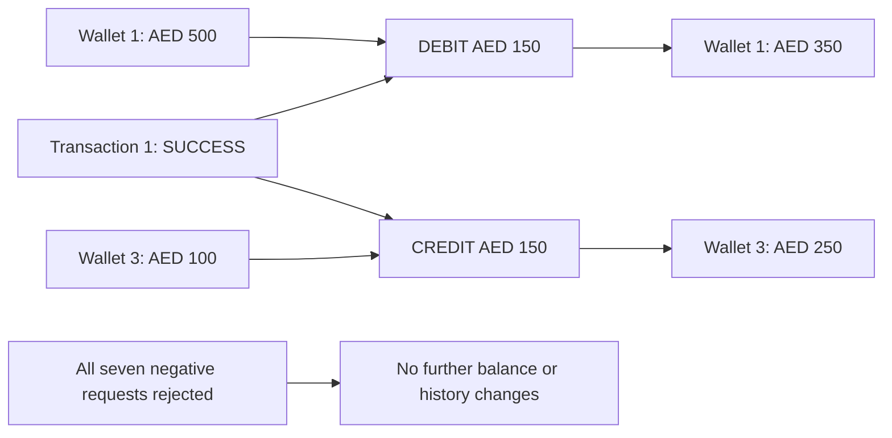

# Transfer API verification — October 25, 2026

Executed real HTTP requests against local FastAPI, PostgreSQL 16, and Redis 7.
The transfer router existed but was not included in `app/main.py`; it is now
registered so `POST /transfers` is available.

## Test accounts and final balances

| Role | User id | Wallet id | Currency | Starting balance | Final balance | Final status |
| --- | --- | --- | --- | --- | --- | --- |
| A — existing user | 1 | 1 | AED | 500.0000 | **350.0000** | ACTIVE |
| B — newly registered test user | 3 | 3 | AED | 100.0000 | **250.0000** | ACTIVE |
| B — currency-mismatch fixture | 3 | 4 | USD | 0.0000 | 0.0000 | ACTIVE |

Test account email: `nexa.transfer.qa.522f0313@example.com`.
Login credentials were provided separately in the chat; no passwords or tokens
are included in this report.

**Fixture setup:** the existing AED wallet had zero balance and no transaction
or ledger history before testing. Starting balances of AED 500 and AED 100 were
set directly in the local development database because top-up is not implemented.
These initial funds do not have opening ledger entries. This report verifies
the transfer delta, not reconciliation of all funds against the ledger.

## Requests and results

All transfer requests were authenticated as user 1. Unless noted otherwise,
sender was wallet 1 and receiver was wallet 3.

| Case | Input / setup | HTTP | Result | AED balances after request: A / B |
| --- | --- | --- | --- | --- |
| Successful transfer | Amount 150 AED | 201 | SUCCESS | 350 / 250 |
| Zero amount | Amount 0 | 422 | Request validation: amount must be greater than zero | 350 / 250 |
| Same wallet | Sender 1, receiver 1, amount 1 | 400 | Sender and receiver wallets cannot be the same | 350 / 250 |
| Different currencies | Sender 1 AED, receiver 4 USD, amount 1 | 400 | Wallet currencies must match | 350 / 250 |
| Insufficient balance | Amount 1000 | 400 | Insufficient balance | 350 / 250 |
| Inactive sender | Set wallet 1 INACTIVE; amount 1 | 400 | Sender wallet is not active | 350 / 250 |
| Inactive receiver | Set wallet 3 INACTIVE; amount 1 | 400 | Receiver wallet is not active | 350 / 250 |
| Another user's sender wallet | Sender 3, receiver 1, amount 1, caller user 1 | 400 | Wallet not found | 350 / 250 |

Inactive statuses were set directly for their individual tests and restored
afterward. Both AED wallets were confirmed ACTIVE at completion. Each negative
case was followed by API balance reads and database history checks: no additional
transaction or ledger entry was created.

## Committed transaction and ledger

- Transaction id: `1`
- Reference: `TXN-f10a305fc3124de497cfac7e8cb75419`
- Sender wallet: `1`; receiver wallet: `3`
- Amount: `150.0000 AED`; status: `SUCCESS`

| Ledger id | Wallet id | Direction | Entry type | Amount | Transaction id |
| --- | --- | --- | --- | --- | --- |
| 1 | 1 | DEBIT | TRANSFER | 150.0000 AED | 1 |
| 2 | 3 | CREDIT | TRANSFER | 150.0000 AED | 1 |



## Scope and next work

These were sequential manual integration checks, not a committed automated test
suite. They did not test simultaneous transfers, lock waiting/deadlocks,
idempotency, network failure during commit, or posting-failure rollback against
PostgreSQL. The successful response and committed database records were checked
together; rejection cases alone do not prove every partial-failure rollback path.

Next: authenticated ledger history, repeatable integration tests, and an explicit
transfer idempotency design. Transaction history verification is recorded below.

## Transaction history API verification — October 28, 2026

Registered the existing transaction router in `app/main.py`, then performed
12 real HTTP checks against the running API and compared results with PostgreSQL.

| Case | Endpoint | Expected and actual result |
| --- | --- | --- |
| Sender history | `GET /transactions` | 200; includes transaction 1 |
| Sender detail | `GET /transactions/1` | 200; matches the list item |
| Receiver history | `GET /transactions` | 200; includes transaction 1 |
| Receiver detail | `GET /transactions/1` | 200; matches the list item |
| Unrelated user history | `GET /transactions` | 200 with an empty list |
| Unrelated user detail | `GET /transactions/1` | 404: Transaction not found |
| Missing transaction | `GET /transactions/10001` | Same 404 response as unauthorized access |
| No authentication | Both endpoints, two checks | 401 |
| Invalid token | Both endpoints, two checks | 401 |
| Non-integer id | `GET /transactions/not-an-integer` | 422 |

The history contents and order were compared with the user's wallet ownership
and database transactions. The current fixture has only one transaction, so
multi-item ordering still needs a larger fixture. A separate unrelated account
was created for access-control checks: user 4,
`nexa.history.qa.e922c710@example.com`, with a default zero-balance AED wallet.

The existing wallet balances, transaction records, and ledger records were
compared before and after the checks and remained unchanged. Wallet 1 still has
**350.0000 AED** and wallet 3 still has **250.0000 AED**. These are manual live
integration checks, not a committed automated regression suite.

## 2026-10-31 — Live PostgreSQL idempotency and concurrency

Executed `scripts/test_live_idempotency.py --run-local` against the local HTTP API,
PostgreSQL 16 and Redis. Migration `587c12b7d3ee` was already at head.
Run ID: `2e480f871d83`. Registered two disposable users and logged in via the API.
Wallets **7 (sender)** and **8 (receiver)** received synthetic test-only opening
balances of **500 AED / 100 AED** directly in the database. These opening funds
are fixtures, not actual top-ups, and have no opening ledger entries.

| Scenario | Key | HTTP | Transaction | Balances (7 / 8) |
| --- | --- | --- | --- | --- |
| Transfer 100 AED | TEST-001 | 201 | 2 | 400 / 200 |
| Same body and key | TEST-001 | 201 | 2, identical response | 400 / 200 |
| Change amount to 200 AED | TEST-001 | 409 | No new transaction | 400 / 200 |
| Three concurrent 100 AED requests | TEST-CONCURRENT-001 | 201 / 201 / 201 | 3 / 3 / 3 | 300 / 300 |

Verified in PostgreSQL for **each key**: one COMPLETED idempotency record linked
to one SUCCESS transaction, exactly one DEBIT and one CREDIT TRANSFER entry of
100 AED. Exactly two transfers were created overall. All pre-existing wallet
balances were unchanged.

Concurrency was observed, not merely assumed: the test held the sender row lock,
started three HTTP requests together, and observed three direct/indirect lock
waiters using `pg_blocking_pids` before releasing the lock. All returned the same
transaction and response body. The script retains its test accounts and financial
records for inspection and never prints credentials or tokens.

Re-run locally (creates fresh fixture accounts each run):

```bash
DEBUG=false .venv/bin/python scripts/test_live_idempotency.py --run-local
```

This verifies this three-request contention scenario. It does not establish
production readiness under load, pool exhaustion, network failures or crashes.
